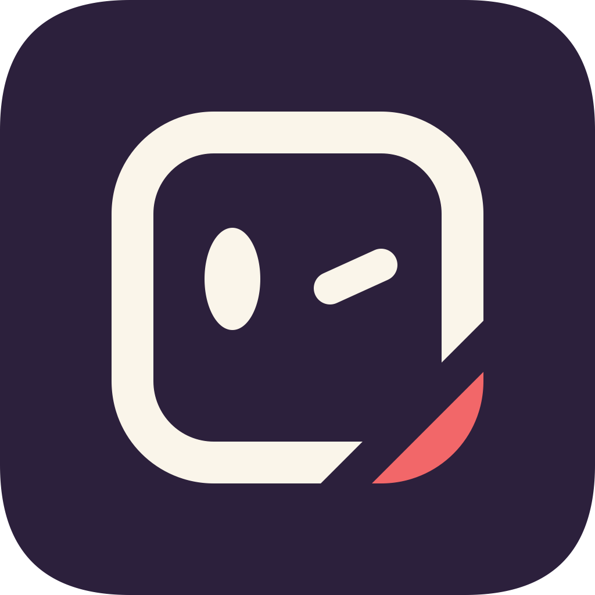

  

<h1 align="center">Mooji Cut</h1>

<a href="README.md">简体中文</a> · <strong>English</strong>

<strong>Consider it captured.</strong>

An open-source screenshot and screen recording app built with MoonBit. Annotate screenshots, edit recordings, add plugins, and explore automation designed for AI agents.

<a href="https://coderserio.github.io/moojicut/">Website</a> · <a href="https://github.com/CoderSerio/moojicut/releases/latest">Download Latest</a> · <a href="docs/guide.zh-CN.md">User Guide</a> · <a href="https://github.com/CoderSerio/moojicut/issues">Report an Issue</a>

## Screenshots and Annotations

Select an area, highlight what matters, and copy the result into a chat, document, or presentation.

- **Mark the details:** Add rectangles, ellipses, arrows, and text. Adjust colors, line widths, font sizes, and opacity.
- **Cover parts of an image:** Use solid rectangles, filled ellipses, or mosaic pixelation with adjustable block size.
- **Keep editing:** Select existing annotations to move or resize them, edit text again, and undo or redo changes.
- **Keep a reference on screen:** Pin a screenshot as a floating image. Resize it, adjust its opacity, hide it, or let clicks pass through it. Pinned images can appear in your next screenshot, too.

## Screen Recording and Editing

Choose what to record and start after a countdown. Continue in the editor to turn a recording into a walkthrough you can share.

- **Cut the extra footage:** Split clips, trim their boundaries, reorder or delete them, and select gaps to close them.
- **Find the right moment:** Zoom and pan the timeline, move frame by frame, or jump forward and backward.
- **Set the pace:** Change clip speed to fit a three-minute task into one minute. Preview speed controls playback separately.
- **Work with audio:** View waveforms, expand audio tracks, unlink audio from video to move it independently, or mute everything with one click.
- **Preserve the original:** Preview edits immediately and export the finished video when you save. Undo, redo, and resume editing drafts.

## AI and Automation

**Read text from images.** Use OCR to turn screenshot content into text you can edit and copy, then choose a target language to translate it. Recognition and translation run locally, and you can revise the results before using them.

**Let agents reuse the editing core.** The MoonBit core already provides structured video editing commands, session snapshots, export plans, and recording capability queries. These library-level interfaces form the foundation for programmatic use and automation.

A complete interface for AI agents is being developed with a **CLI-first** approach: discover capabilities, find sessions, submit edits, and query or cancel tasks. Scripts and agents will use the same operation rules as the UI. The standalone CLI is not yet included in release packages. See the [automation design (简体中文)](docs/architecture.md#cli-和-agent) for the interfaces and implementation status.

## Plugins: Put Your Tools in the Toolbar

Enable, disable, and reorder tools in Settings → Plugin Management to suit the way you work. Built-in screenshot tools and imported user tools share one list. New tools are appended, and settings are saved automatically.

**Write MoonBit → compile to Wasm → package as ZIP → import and use.**

- **One plugin, multiple tools:** Declare plugin details and tool entry points in a manifest. Each tool can be enabled, disabled, and reordered separately.
- **Follow a defined contract:** Implement a fixed entry point, accept host parameters, and return a result. No project-specific SDK is required. Distribute the manifest, Wasm module, and optional icon together.
- **Use it after import:** Import the ZIP, then run its tools from the screenshot toolbar. A result window displays text and offers a copy action. Installing a plugin does not require rebuilding the app.
- **Run in a separate process:** Plugins execute in a dedicated worker process. The host validates packages, enforces invocation limits, handles cancellation, and checks results.

The [Numbered Box example](plugins/examples/numbered-box) includes a drag-to-annotate tool and a tool that shows screenshot dimensions. Build the ZIP once and import it on all three platforms. Rebuild older v1 ZIPs for the new contract. [Plugin authoring guide (简体中文)](plugins/user-runtime/README.md)

Screenshot plugins receive image metadata and selection coordinates. They can display text or add a batch of annotations that users can undo in one step. [Plugin design (简体中文)](docs/architecture.md#插件机制)

## Downloads and Compatibility

[Official downloads](https://coderserio.github.io/moojicut/#download)

Current release: **[0.1.0-alpha.23](https://github.com/CoderSerio/moojicut/releases/latest)**. The project is still in alpha. The sections above describe the full product feature set; the table below shows what is currently available on each system.

| Platform and download | Requirements | Current features |
| --- | --- | --- |
| [macOS · Apple Silicon ZIP](https://github.com/CoderSerio/moojicut/releases/download/v0.1.0-alpha.23/moojicut-0.1.0-alpha.23-macos-arm64.zip) | macOS 26+ | Screenshot annotations, pinned images, OCR and translation, plugin management and import; region, window, and full-screen recording with system audio, plus the timeline editing features described above. |
| [Windows · x64 ZIP](https://github.com/CoderSerio/moojicut/releases/download/v0.1.0-alpha.23/moojicut-0.1.0-alpha.23-windows-x64.zip) | Windows 10/11, Intel / AMD | Screenshot annotations, pinned images, plugin import, silent region recording, and shared timeline editing. |
| [Linux · x86_64 tar.gz](https://github.com/CoderSerio/moojicut/releases/download/v0.1.0-alpha.23/moojicut-0.1.0-alpha.23-linux-x64.tar.gz) | An Ubuntu 22.04+ compatible environment with the [system dependencies (简体中文)](docs/guide.zh-CN.md#下载与开始使用) | Screenshot annotations, pinned images, plugin import, silent WebM recording, and shared timeline editing. Select a region on X11 or choose a source through the system portal on Wayland. |

OCR and translation are available on macOS. Windows and Linux record up to 1920 × 1080 at 15 fps, without audio or pause support. Both show the default icon for imported plugins. On Wayland, keeping windows on top, positioning, and input depend on the desktop environment. System authorization, multiple displays, and mixed DPI setups still need testing on physical devices.

Scrolling capture is currently disabled. Video editing uses a single recording; importing multiple source files, subtitles, transitions, and zoom-and-pan keyframes are not yet supported. User plugins cannot currently access image pixels, the network, or files, or provide custom interfaces. The CLI and recording and editing plugin extensions are still in development.

The downloaded app does not require MoonBit, Node.js, or Python. SHA256 checksum files accompany the packages. On macOS, unzip the app and move it to Applications; check for and install updates in Settings. On Windows and Linux, download and verify an update, then manually extract it to replace the old version. The macOS app is signed with a development certificate but is not yet notarized by Apple; the Windows app is unsigned. See the [user guide (简体中文)](docs/guide.zh-CN.md) for installation and permissions.

## Built with MoonBit

MoonBit handles shared interactions, image documents, recording state, and video editing rules. Platform adapters provide windowing, input, capture, and media capabilities. User plugins compile to WebAssembly and run in the runtime bundled with the app.

- [Build from source (简体中文)](docs/guide.zh-CN.md#从源码构建)
- [Architecture and implementation plan (简体中文)](docs/architecture.md)
- [Create your first plugin (简体中文)](plugins/user-runtime/README.md)

Bug reports, interaction improvements, plugins, and code contributions are welcome.

## License

[MIT License](LICENSE). Third-party components are covered by their respective licenses.
