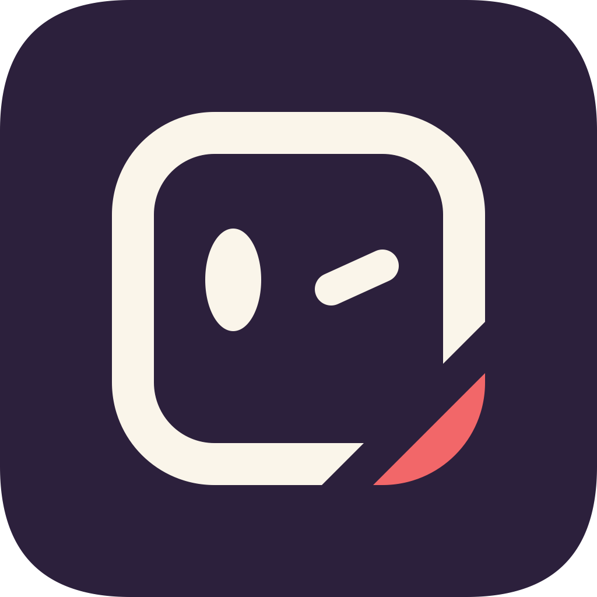

  

# Mooji Cut

[English](README.md) · 简体中文

**这一幕，我截下了。**

简洁的截图与录屏工具，MoonBit 驱动。截取画面、标出重点、剪辑录屏，让日常操作保持直接。未来，你还可以通过插件添加需要的能力。

[下载预览版](https://github.com/CoderSerio/moojicut/releases) · [反馈问题](https://github.com/CoderSerio/moojicut/issues) · [查看源码](https://github.com/CoderSerio/moojicut)

## 为什么选择 Mooji Cut

- **简洁优先。** 围绕截图、标注和基础剪辑，做好每天都会用到的操作。平时留在菜单栏或托盘，需要时随手唤起。
- **按需扩展 · 规划中。** 计划开放插件开发，让你为自己的工作流程添加能力，同时保持默认体验简洁。
- **本地完成。** 截图、录屏与编辑在本机进行，处理后的内容由你决定如何保存和分享。

## 捕捉与编辑

| 场景 | 用 Mooji Cut |
| --- | --- |
| 截图说明 | 框选画面，用箭头、矩形和文字标出重点，遮住敏感内容，复制到聊天或文档。 |
| 录屏演示 | 记录操作过程，裁掉首尾、删除多余片段、调整画面范围，再导出视频。 |

编辑支持撤销与重做，可以边试边调整。

Mooji Cut 目前处于早期预览阶段。本文介绍开发中的功能，发布包可能尚未包含全部能力。各平台的具体支持范围与已知限制，请查看对应版本的发布说明。

## 插件计划

我们希望 Mooji Cut 能适应你的用法。

未来计划开放插件开发，让社区能够补充处理能力、连接其他工具，或组合自己的工作流程。基础体验保持简洁，更多能力按需添加。

**插件系统尚未上线，扩展范围与接口仍在规划中。** 欢迎带着实际使用场景参与讨论。

## 开始使用

前往 [发布页](https://github.com/CoderSerio/moojicut/releases)，下载适合你系统的版本。安装方式、权限设置和版本变化均随发布说明提供。开发版的完整操作说明见[使用与构建指南](docs/guide.zh-CN.md)。

## 开发与贡献

Mooji Cut 的标注与剪辑核心使用 **MoonBit** 编写，搭配各平台的原生界面与系统采集能力。

开始开发前，请参考[源码构建说明](docs/guide.zh-CN.md#从源码构建)。

欢迎提交问题、改进交互、贡献代码，也欢迎一起讨论插件应该怎样融入日常使用。

## 许可

[MIT License](LICENSE)。第三方组件遵循各自的许可。
