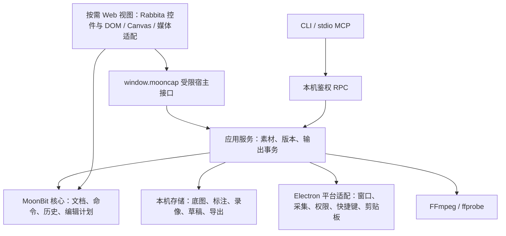

# 架构说明

## 产品与宿主边界

Mooncap 是人和 Agent 共用的本地截图与录屏工具，产品行为以 [PRD](prd.md) 为准。默认仅托盘待命：截图在冻结桌面中完成选区和标注，录屏结束后打开编辑窗，最近记录与设置按需打开。早期 [交互草案](interaction-design.md) 保留作背景，不再代表当前入口。

当前使用 **Electron 45.3.1 作为开发宿主**，MoonBit 编写文档与编辑规则，Rabbita 0.17.0 编写截图和视频编辑控件。窗口按需创建、关闭销毁；录制视图和临时离屏渲染视图有各自的生命周期。没有常驻主窗口不等于没有 Chromium 空闲开销，当前也不是系统 WebView 或全原生实现。

宿主替换方向是系统 WebView 加原生采集、权限、托盘和剪贴板适配，保留 MoonBit 文档及标准 Web 界面。这是后续迁移边界，不能把已有接口分层当成迁移已完成。

## 分层与模块

| 位置 | 当前职责 |
| --- | --- |
| `core/src/image_model.mbt` | 图片文档、标注验证、命令、版本、选区、撤销重做和完成时坐标转换 |
| `core/src/video_document.mbt`、`timeline.mbt`、`geometry.mbt`、`export_profile.mbt`、`recording.mbt` | 视频文档与历史、保留片段、时间映射、画面裁切、编码预算和录制状态转换 |
| `ui/image/`、`ui/video/` | 固定依赖 Rabbita 0.17.0 的 MoonBit 界面，分别编译到 `dist/ui/image.mjs`、`video.mjs` |
| `src/renderer/image-editor.*`、`image-render.mjs` | 指针与键盘、DOM 文字输入、画布预览、共用 PNG 渲染、宿主调用 |
| `src/renderer/video-workspace.mjs` | 视频播放、时间线手势、Canvas 裁切预览与 MoonBit 视频会话的接线 |
| `src/renderer/record-setup.*`、`recorder.*`、`recording-region.mjs`、`control.*` | 录制准备、倒计时、独立媒体采集、编码前区域裁切和停止入口 |
| `src/renderer/library.*`、`pin.*`、`render.*` | 最近记录/设置、实时贴图、临时离屏图片渲染 |
| `src/main/application.mjs`、`application-ipc.mjs` | 共享应用服务、输出事务、受限 IPC、窗口角色与素材归属校验 |
| `src/main/desktop-host.mjs`、`main.mjs` | 按需窗口、托盘、快捷键、退出控制、启动和应用数据目录 |
| `src/main/image-store.mjs`、`recording-store.mjs`、`preferences.mjs` | 图片串行修改与落盘、录像写入与恢复、设置 |
| `src/main/media-*.mjs`、`platform-clipboard.mjs`、`platform/` | 媒体读取、输入校验、编码进程、原生图片/文件剪贴板 |
| `src/main/agent-server.mjs`、`agent/` | 本机 HTTP 服务、CLI、MCP 与参数约束 |
| `src/preload.cjs` | 将固定的宿主方法和事件暴露为 `window.mooncap` |

MoonBit 核心不依赖 Electron 或 DOM，当前编译目标是 JavaScript ESM。Rabbita 已实际用于界面，但不是所有视图、指针状态或 DOM 行为都已迁入 MoonBit：Canvas、文本输入法、媒体 API 和部分交互暂态仍由 JavaScript 适配。渲染页通过受限桥接访问宿主，不直接读取任意文件或启动进程。

## 窗口与资源生命周期

默认启动初始化存储、设置、托盘、快捷键和本机 Agent 服务，不创建主窗口。`--workbench` 作为兼容的开发参数打开最近记录/设置，不再打开旧编辑工作台。

- 截图创建桌面覆盖层或普通图片编辑窗；确认或取消后销毁。历史和导入使用普通窗口。
- 录制准备创建冻结桌面选区页；权限和媒体来源准备完成后倒计时，开始时关闭准备页。独立隐藏录制视图拥有媒体流，停止浮条只发控制命令，关闭编辑页面不会结束采集。
- 停止时等待最后媒体块、写入队列、文件关闭与探测；之后释放媒体流和录制视图，进入视频编辑或退出收尾。
- 图片后台预览按任务创建隐藏渲染视图，使用与编辑器相同的绘制模块，完成后销毁；没有为此常驻隐藏工作台。
- 最近记录、视频编辑和贴图是按需窗口。关闭贴图只销毁视图，不删除素材；穿透模式可从托盘恢复交互。

Electron 主进程、托盘和 Chromium 基础进程仍常驻。录制和编码有独立的任务状态，退出或清理文件须检查这些状态，避免截断正在写入的素材。

## 截图文档与渲染

区域截图先保留当前显示器的冻结底图。编辑坐标以底图物理像素为准，窗口位置与鼠标事件使用系统逻辑坐标；适配层根据实际画布显示尺寸转换，不能直接把 `scaleFactor` 当作所有环境的固定比例。

核心文档包含 `width`、`height`、`revision`、`viewport`、`annotations`、`undo` 和 `redo`。初始区域选取的 `viewport` 为 `null`；选区确定后执行 `crop`。常用命令为 `add`、`update`、`remove`、`move`、`resize`、`order`、`crop`、`undo`、`redo`，通过 `image_apply` 校验并产生新文档。一次提交形成一个历史步骤，会话内最多保留 100 步。

`ImageStore` 是图片权威状态，人工 UI 与 Agent 的提交共用按素材串行执行的服务。调用方携带 `expectedRevision`；过期操作拒绝并提示重新读取，不用旧状态覆盖新编辑。UI 的拖动和文字输入可以先做临时预览，提交后以服务返回的文档为准。

改变选区只改变 `viewport`，不移动标注，也不提前把标注烘焙进底图。同一次会话扩大选区可以恢复冻结底图中的内容。确认、保存或贴图成功后，宿主裁出最终选区底图，`image_finalize` 将对象坐标转换到新原点、更新尺寸和版本、清空依赖旧底图的历史。重开仍保留可编辑对象，但不能恢复选区外的画面。

`image-render.mjs` 供编辑预览、输出、Agent 后台渲染和贴图共同使用。渲染先投影到最终选区坐标，再处理像素与标注，使完成前后保持一致。马赛克从底图采样，实色遮挡不透明地覆盖对应底图，普通标注绘制在遮挡结果上方；整对象橡皮擦只删除标注。普通 PNG 输出只包含最终像素，不附带原图或可编辑层。本机历史则明确保留可编辑底图和对象。

文字使用 DOM 输入控件处理组合输入、选择、多行与文字剪贴板，提交后成为文档对象。输入法组合期间不执行编辑器快捷键。已选对象的样式、位置、尺寸、顺序、删除以及选区修改均进入共享撤销历史；仅修改新建工具默认样式不修改文档。

完成接口同时携带 PNG 和生成它的文档版本，宿主校验版本及尺寸，防止将旧像素结果写到新版本上。增量文档通知可以不包含底图；UI 和贴图保留原底图，仅在完成后的坐标转换等底图变化时重新加载，并忽略过期通知。

## 录制、剪辑与输出

宿主选择并授权采集来源，独立录制视图通过媒体流和 MediaRecorder 产生 WebM。所选区域先映射到实际流尺寸，再通过 Canvas 裁出后编码；不把全屏原始录像当作区域录屏的存储结果。系统声音与麦克风按选项获取，需要同时录入时混合音轨；权限拒绝或没有获得所选声音时返回错误。系统声音支持仍取决于平台，当前 Linux 入口禁用该选项。

媒体块按顺序发送和写入，停止要等待最终块与写入队列结束，再通过 ffprobe 获取时长和尺寸。来源中断、分辨率变化、显示器变化和写入失败走停止/恢复路径；保留可检查的数据，不把采集失败显示为成功。真实中断行为需要结合平台验收。

视频编辑会话由 MoonBit 保存文档与历史。首尾范围、中段删除、整片裁切和静音共同生成保留片段与导出计划；预览按同一计划跳过删除区间，并区分原片时间与成片时间。UI 不从 DOM 字段拼装一份独立的最终剪辑状态。编辑草稿与原始录像分开保存，重开可恢复参数；视频时间标注、外部视频导入和 Agent 录屏控制属于 P1。

FFmpeg 按校验后的计划处理和编码，使用参数数组启动，不拼接 shell 命令。轻量分享默认按 25 MiB 估算码率，这只是预算，不保证最终文件小于目标。输出先写临时文件，完成媒体校验后再改名为最终文件；取消和失败清理未完成输出并保留原件与草稿。

默认确认生成托管 MP4 并复制**文件**，另存为可选择路径。macOS 使用 AppKit 辅助程序，Windows 有 PowerShell 文件剪贴板适配，Linux 使用文件 URI MIME 格式；这些实现不能代替各平台和目标聊天应用的实测。为避免后台编码覆盖用户新复制的内容，开始编码时记录剪贴板版本，结束时仅在版本仍一致且可判断时自动写入，否则保留成片并提供再次复制。

已完成 MP4 不作为会自动过期的临时缓存，关闭窗口、退出应用和下一次导出不会删除它。清理原始录像与清理导出文件是独立的明确操作，任务正在使用的文件不可删除。

## 本机数据与 Agent

应用数据根目录默认由 Electron `userData` 提供，CLI 使用对应平台路径；`MOONCAP_HOME` 可以统一覆盖。其下分别保存 `images/`、`recordings/`、`exports/`、`preferences.json` 与 `agent/connection.json`。

未完成的新截图只在内存中保留，取消不进入历史。完成图片的底图按需从磁盘读取；关闭图片会释放底图缓存与撤销栈。历史缩略图按可见范围串行生成，并限制缓存数量。完成的图片保存最终选区底图与标注，后续已提交修改落盘；重开不恢复旧撤销栈。录像保存原件和独立剪辑草稿，导出另建文件，不覆盖原件。用户明确删除以外不自动清理已完成输出。

Agent 服务只监听 `127.0.0.1` 随机端口，使用随机令牌验证请求，并限制方法、请求体、Host 与浏览器来源。连接文件限当前用户访问。CLI 和 stdio MCP 均经此服务进入与人工相同的应用层；应用未运行时可后台启动，`MOONCAP_AUTOSTART=0` 可禁用该行为。

当前提供 `status`、`list_windows`、`capture`、`import_image`、`list_captures`、`get_capture`、`annotate`、`crop`、`undo`、`redo`、`preview`、`export`、`present`、`pin`、`copy`。普通操作静默，只有 `present` 和 `pin` 主动打开视图；`status.activeCaptureId` 用于接续人工截图。Agent 修改使用预期版本，确认导致坐标转换后必须重新读取。Agent 普通复制只改变剪贴板，不结束人工会话。

## 构建、打包与验证边界

`npm run build` 构建 MoonBit 核心、两个 Rabbita 界面与当前平台原生辅助程序。开发环境需要 Node.js、npm、MoonBit、FFmpeg / ffprobe；macOS 还需要 `clang`。工具链查找及完整命令见 [README](../README.md#本地开发)。

`npm run package` 当前仅处理 macOS 本地 `.app`。它验证项目指定的 Electron 运行时，包含编译产物和剪贴板辅助程序，并收集 FFmpeg / ffprobe 的非系统依赖、调整库路径、执行本地签名和媒体小样校验。这里的本地签名用于修改二进制后的完整性，不是 Developer ID 分发签名；脚本不执行公证，Windows / Linux 包也尚未交付。

2026-11-13 当前自动化记录为 MoonBit JS 后端 14 项、Node 测试 29 项通过；截图隔离 UI 检查还覆盖裁剪前后像素一致性、历史重开与贴图更新。实际运行的核心是 JS 后端，不用早期 native 测试替代它的结果。

真实权限、系统声音、混合缩放与多显示器、保存对话框、实际录制中断、MP4 播放以及目标应用的图片/文件粘贴仍需要桌面验收。当前首先验收 macOS，Windows / Linux 未完成实机验证。详细状态以 [README](../README.md#验证状态与限制) 和后续验收记录为准，不将实现存在或测试素材通过写成全部 P0 已验收。

## 可替换宿主的后续工作

迁移时优先保留文档格式、命令语义、版本冲突规则、渲染行为与导出计划。需要替换的是托盘/窗口生命周期、屏幕与音频采集、权限、全局快捷键、文件剪贴板、文件对话框、媒体进程及本机服务的接线。

系统 WebView 可以继续承载现有标准 Web 与 Rabbita 界面，但还需验证 Canvas、输入法、媒体播放和窗口行为；原生采集也需要重新验证区域坐标、声音、控件排除与中断恢复。当前代码仍有明确的 Electron 平台实现，不能假设仅替换一个 import 即可完成迁移。UI 库选型以可用、可维护为先，没有 TSX 或新语言语法要求。
