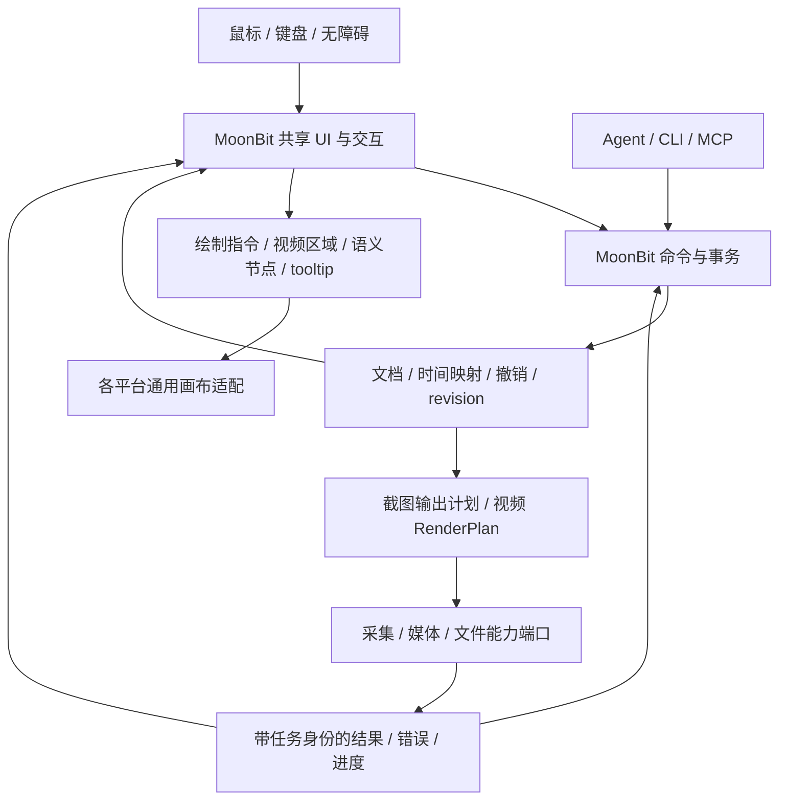

# Mooji Cut 共享架构与迁移计划

2026-11-17。本文描述当前源码和后续拆分顺序。历史 Electron 方案不再作为
新功能的实现依据；实现状态以当前原生宿主为准。

## 决策

复杂 UI、交互规则和编辑模型由 MoonBit 编写一次。每个平台只实现窗口、绘图、
输入/输入法、无障碍、屏幕采集、媒体解码/播放/导出、文件及系统权限等适配。
MoonBit native 编译为各目标平台的静态库，再与对应适配层链接；不是一个 macOS
二进制直接在 Windows/Linux 运行，也不是自动把 AppKit UI 转成跨平台 UI。

Agent 直接提交与 UI 相同的命令，不用模拟点击。图中 Agent 是目标接线方式：已有
核心命令与 revision 校验不代表三个原生宿主均已提供完整的 CLI/MCP 入口。

## 当前复用程度

| 范围 | 已有共享实现 | 仍需平台实现或迁移 |
| --- | --- | --- |
| 图片文档、选区几何、工具配置 | `src/internal/image`、`selection`、`tool_registry`；`capture_ui` 负责矩形/箭头/遮挡草稿与浮动工具栏定位 | macOS、Windows、Linux 已接入上述共享交互；工具栏控件绘制、属性面板、文字输入和窗口命中仍需继续迁移 |
| 录屏选区 | macOS 截图与录屏共用 `components/selection` 和 `desktop_capture` | 这两个是 macOS 组件；录屏 hover/准备/倒计时 UI 尚未成为三端共享 MoonBit UI |
| 视频编辑 | `video_project` 管文档与命令；`video_ui` 管布局、图标、时间轴、手势、tooltip 和语义 | macOS 正式编辑器已接入；Windows 仍有旧编辑器，Linux 尚未接入同等录屏/编辑功能 |
| 音频波形 | `video_ui/waveform.mbt` 管源时间映射、峰值查询和绘制 | `components/media_analysis/macos` 负责解码音频、异步生成包络，另外两端尚未接入 |
| 通用画布 | MoonBit 输出平台无关绘制指令和语义节点 | `components/shared_canvas/macos` 实现 AppKit/AVPlayerLayer；Windows/Linux 适配待补 |

三端构建通过只证明各自包能构建，不能据此宣称三端功能或交互一致。

## 目录与所有权

沿用现有目录根，按职责迁出代码，避免一边改功能一边制造大面积路径变化。

| 目录 | 职责 |
| --- | --- |
| `src/internal/{image,selection,video,video_project,...}` | 无平台依赖的模型、几何、策略、命令和时间映射 |
| `src/internal/video_ui`、`capture_ui`，后续 `recording_ui` | 共享复杂组件，输入事件生成绘制/语义及明确效果请求；`capture_ui` 当前先覆盖形状草稿和浮层定位 |
| `components/shared_canvas/<platform>` | 通用绘图、事件坐标、焦点、输入法、无障碍和 tooltip 的系统桥接；不解释业务动作 ID |
| `components/{desktop_capture,media_analysis,...}/<platform>` | 可被多个功能复用的系统能力，不拥有编辑文档或工具栏 |
| `plugins/feature/<feature>/<platform>` | 薄宿主：功能接线、窗口生命周期、任务取消；逐步迁出其中的业务 UI |
| `native/<platform>` | 启动、托盘、设置、系统快捷键、更新及应用级资源协调 |
| `native/shared`、`src/api_*.mbt` | 有版本的跨语言边界，封装 FFI 内存所有权与校验 |
| `plugins/system/builtins.json` | 组件依赖和构建源文件的单一清单 |

截图和录屏共用选区交互，但输出动作不同：截图提交图片文档，录屏提交区域或
窗口引用及音频选项。视频编辑继续拥有自己的时间轴模型，不能强塞入截图状态机。

## 本轮实现边界

1. 截图的窗口保留名单包含可见贴图和视频编辑器。隐藏/最小化的编辑器不被唤起；
   设置和录制控件仍被排除。视频编辑器不因截图而关闭、重建或修改草稿。
2. 录屏准备控件提供动作、状态和快捷键提示。视频编辑器沿用 MoonBit 的语义名称
   映射到 tooltip；不把常驻说明文字塞回工具栏。
3. 波形从原始音频生成，只是可丢弃的展示数据，不进入文档、撤销历史或导出计划。
   解码在后台进行，关闭窗口取消任务；失败不阻塞编辑。当前单素材契约为原片
   `durationMs` 加最多 16,384 个均匀峰值。每个峰值为声道绝对振幅最大值，范围
   0–1，静音为 0；不是频谱或响度计。多轨源由媒体端口先混音。
   MoonBit 根据片段源区间、实际倍率、时间轴偏移和可见视口查询峰值并绘制，
   因此切分、重排、变速不会重复解码。长素材缩放精度受当前包络分辨率限制。

## 后续按依赖推进

### 已落地：三个截图交互案例

`capture_ui` 的矩形、箭头、遮挡现在接入真实 macOS 编辑画布。按下时冻结工具、
样式与稳定 ID；移动只返回预览；松开返回一次 `image_apply` 可直接消费的 `add`
命令；Esc、切换工具、停用当前工具会取消草稿。反向拖拽、水平/竖直箭头、
源图边界和小范围误触的规则统一在 MoonBit，文档与撤销仍由 `image` 唯一管理。
Agent 可以直接提交相同命令，不需要模拟手势。

浮动工具栏的右下对齐、避让屏幕边缘、属性行高度与内容宽度也由 MoonBit 决定。
macOS 负责坐标转换、控件测量和绘制。工具栏只有两个视觉组：左侧标注、用户
工具、OCR/翻译和撤销/重做；右侧贴图、取消、完成。贴图开关仍来自原注册表，
历史排序配置保留，但不会把贴图插回左侧。其余用户工具保持相对顺序。

这只是第一批迁移案例，不等同于截图 UI 已完全共享。`capture_ui` 的同一事件
回放已在 native 和 JS 目标验证；Windows/Linux 通过 `image_session_shape_*` 薄适配调用同一 reducer，属性范围、显隐、形状切换和撤销也复用 MoonBit。原生层仍负责系统控件、文字输入和像素绘制。
控件绘制、输入法适配和平台窗口验收仍按下列顺序继续。

形状扩展沿用这条边界：`editor_style` 管方框/圆框/马赛克的可用选项、独立偏好和
条件属性；`capture_ui` 生成带变体的草稿；`image` 通过 `setShape` 命令完成已有
标注的切换与撤销，并按椭圆实际轮廓命中。macOS 的 `components/image_effects`
只采样像素，不持有文档。截图预览、实时文字遮挡和 PNG 导出复用同一绘制流程。
这批新控件仍是 macOS 适配；其他两端尚未接线，不能据此宣称三端已支持这些形状。

### 1. 共享选区和录屏准备 UI

继续将 `MCRecordingSelectionView` 和截图的选区/工具栏交互迁到 MoonBit `capture_ui`
和 `recording_ui`。共用坐标、命中、窗口 hover、手势取消、焦点、主题、提示和
无障碍语义；宿主只回报屏幕/窗口列表、冻结底图和输入事件。先替换 macOS 并
对照现有行为，再接第二个平台。验收包含首击、透明区域不漏鼠标、跨屏切换、
取消后晚回调失效和视频编辑器可截图，不能只直接调用 view 的 `mouseDown`。

### 2. 第二个平台验证同一份复杂组件

先补 Windows 的通用画布适配，接入现有 `video_ui` 和新的选区组件，不重写
一套时间轴控件。接入真实窗口输入、视频层、无障碍、tooltip 后，再补 Linux
画布适配。Linux 的 X11/Wayland 采集授权作为能力差异明确报告，不改变文档语义。
每个平台运行同一事件回放，比较输出语义和命令；真实媒体与窗口行为分别验收。

### 3. 统一媒体与应用能力端口

将视频媒体宿主抽成明确的 probe、preview、seek、export、waveform、thumbnail
端口。保持同一个 RenderPlan，平台可使用系统库或经过评估的共享媒体库。
新增多素材时，包络缓存按素材指纹、流和分析版本区分，并提供分辨率层级；
不能用路径或当前剪辑长度作为缓存身份。长任务统一带任务身份、取消、进度和错误，
过期结果不得覆盖当前会话。

### 4. 接入 Agent，最后独立成库

先复用现有 revision、requestId、命令校验和不可变原片规则，再接原生应用服务的
CLI/MCP。自动化编辑与人工编辑得到同一文档和导出计划，呈现窗口是显式动作。
至少有两个真实平台消费者后再抽公共库，确保库只依赖模型、绘制协议和端口，
不携带 Mooji Cut 更新、设置、草稿路径等应用策略。

## 验证

`scripts/check-shared-video-ui.py` 覆盖共享核心、真实媒体与波形解码、共享画布。
`test/native/capture-permission.m` 验证窗口过滤与生命周期；
`test/native/recording-experience.m` 验证真实编辑宿主、波形接线、草稿和导出。
`capture_ui` 的白盒测试验证草稿/命令/布局；`test/native/tool-layout.m` 和
`capture-overlay.m` 验证正式截图画布、两组工具栏、插件开关、IME、缩放及导出。
这些是自动化范围，不能代替三端的真实窗口、权限和键鼠回归。

### 2026-11-17：截图三端接入

这批完成形状标签、方框/圆框/实心覆盖/马赛克、颗粒调整、共享绘制手势、右下角工具栏定位和两组工具菜单。Windows/Linux 都读取 MoonBit 的属性显隐与形状范围；马赛克预览和导出采样已合成的场景。Windows 在冻结桌面之后才隐藏贴图，Linux 不再在截图前隐藏贴图，允许再次截取贴图。

剩余平台差异按以下顺序推进，不以这批截图接入宣称整个应用功能对齐：

1. 复用 `tool_registry` / `plugin_protocol` 接入两端插件管理与 Wasm 执行；接真实 OCR/翻译后再开放入口。
2. 实现 Windows/Linux 通用画布后端，直接消费现有 `video_ui` 绘制、语义与事件协议；不再新增原生时间线和剪辑状态。
3. 接媒体预览/导出端口及录屏入口；Linux 分别验证 X11 和 Wayland Portal，Windows 验证混合 DPI、多显示器和 IME。
4. 更新与签名/安装策略按平台验证，避免用 macOS 更新链代替其他平台的分发闭环。
