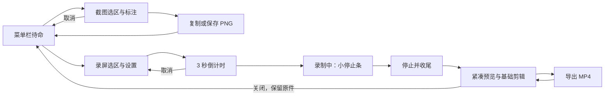

# Mooncap 交互初稿

> 历史草案。最新产品行为以 [产品需求文档](prd.md) 为准，尤其是默认确认复制、截图工具范围、视频剪辑范围和文件生命周期。本文不再作为新实现的验收依据。

> 版本：v0.1，2026-11-13。本文用于直接修改和迭代产品交互，不是已完成能力清单。
>
> 当前已提供菜单栏/托盘后台入口，截图、录屏、剪辑界面仍是显式打开的开发工作台（workbench）。桌面选区覆盖层、就地工具条和录制结束后才出现的独立编辑窗尚未实现；当前验证与限制见 [README](../README.md)。

## 1. 产品形态

Mooncap 平时只驻留在菜单栏或系统托盘，没有常驻主窗口。用户在需要截图或录屏时唤起，完成后回到原来的工作。

- **截图**：桌面选区 → 就地标注 → 复制或保存 → 工具消失。
- **录屏**：选区与声音设置 → 3 秒倒计时 → 小停止条 → 停止后打开紧凑预览 → 基础剪辑 → 导出 MP4。
- **历史与设置**：从菜单栏按需打开，不占据默认启动界面。
- **开发工作台**：只用于调试现有采集与编辑链路，不作为正式产品首页。

## 2. 菜单栏与快捷键

空闲时菜单提供「截图」「录屏」「最近录制」「设置」「退出」。录制中显示已录时长和明确的「停止录制」，不再提供第二个录制入口。

初稿快捷键如下；实现时应检查系统占用，注册失败时保留菜单入口，并允许用户修改。这里的 `⌘ / Ctrl` 分别指 macOS 与 Windows/Linux。

| 操作 | 初稿默认值 | 生效范围 |
| --- | --- | --- |
| 唤起截图 | `⌘ / Ctrl + Shift + 1` | 全局；录制中不另开截图会话 |
| 唤起录屏 | `⌘ / Ctrl + Shift + 2` | 全局；已有会话时只显示当前控制 |
| 停止录制 | `⌘ / Ctrl + Shift + X` | 全局；与当前工作台快捷键一致 |
| 复制截图 | `Enter` 或 `⌘ / Ctrl + C` | 截图选区完成且未编辑文字时 |
| 保存截图 | `⌘ / Ctrl + S` | 截图工具内 |
| 取消 | `Esc` | 选区或倒计时；不作为全局停止录制键 |

关闭临时窗口后应用继续驻留。正在录制时点击退出，应提示「停止并退出」或「继续录制」，避免直接丢弃正在写入的原件。

## 3. 截图：在桌面上完成

1. 唤起后检查权限，冻结当前显示器画面，显示十字光标和轻提示「拖动选择区域，Esc 取消」。
2. 拖动时显示实际输出像素尺寸；松开后出现选区边框、调整手柄和贴近选区的工具条。
3. 工具条提供矩形、箭头、文字、不透明遮挡、撤销和裁切调整。工具条不能超出屏幕边缘，也不能被写入截图结果。
4. 标注直接作用于选区内；颜色和线宽只在相关工具选中时出现，不默认展开设置面板。
5. 复制成功后显示短提示「已复制图片」，覆盖层与工具条一起消失，焦点回到原应用。保存成功同样收起。
6. 关闭保存对话框返回原选区；复制或保存失败时保留画面和标注，允许重试。

默认复制内容是 **PNG 图片数据**，不是图片路径。遮挡使用不透明像素覆盖；不把半透明色块或模糊效果描述为可靠的敏感信息移除。

文字输入时，字母键用于输入，`Enter` 换行，`⌘ / Ctrl + Enter` 完成文字。`Esc` 先取消当前文字输入；退出文字编辑后再按 `Esc` 才取消本次截图。普通选区状态按 `Esc` 直接取消，不再确认临时截图是否保存。

## 4. 录屏：准备、录制、结束分开

### 录制准备

在桌面选择录制区域后，显示小设置条：区域尺寸、麦克风、系统声音、鼠标指针和「开始录制」。可以调整选区或取消，不能选完区域就立即开始。

- 麦克风和系统声音默认关闭；鼠标指针初稿默认显示。
- 仅显示当前平台真正可用的声音与指针选项；不可用时说明原因，不接受设置后静默忽略。
- 首次授权、设备检查在倒计时之前完成；声音设备失败时由用户选择重试或不带该声音继续。
- 点击「开始录制」后显示 3、2、1；`Esc` 取消倒计时并返回准备状态。

### 录制中

原选区不再覆盖编辑工具。小停止条只保留录制标识、时长和 **「停止」文字按钮**，菜单栏同时显示录制状态。小条尽量放在选区外；不能可靠排除自身时，以菜单栏和停止快捷键为主要入口。

不自动打开预览、不反复抢焦点、不拦截被录应用的 `Esc`。重复按唤起快捷键只显示当前控制，不产生第二路录制。暂停/继续可后续加入，首版不要求在小条里堆满控制项。

### 停止与预览

点击停止后先进入「正在完成录制」，停止按钮禁用，等待末尾数据写入完成。完成后才打开紧凑预览窗，提供：

- 播放、暂停与定位；默认停在开头，不突然出声播放。
- 拖动首尾手柄保留片段；可删除一段中间内容。
- 画面裁切、静音、撤销，以及「导出 MP4」。
- 「重新录制」保留已有原件，关闭编辑窗也不删除原件。

预览窗只在需要时出现，不演变成常驻项目管理首页。系统异常导致停止时先提示「录制已中断，已保留原件」，由用户打开预览，避免强行抢走焦点。

## 5. MP4 分享与文件语义

导出提供「适合分享」和「更清晰」两个预设，展示预计大小。适合分享默认按 25 MiB 预算估算；预计超出时直接提示，不承诺硬性文件大小保证。

点击 **「导出 MP4」** 后显示进度与取消入口。成功后提供「复制文件」「显示位置」，另在更多菜单提供「复制路径」。三者含义必须分开：

| 操作 | 结果 | 失败或不支持时 |
| --- | --- | --- |
| 复制文件 | 把已生成的 MP4 作为文件放入系统剪贴板，供聊天或文件管理器粘贴 | 明确提示不支持文件复制，提供「显示位置」；不偷偷改成复制路径 |
| 复制路径 | 复制本机文件位置的文本 | 使用「已复制路径」提示，不显示「已复制视频」 |
| 显示位置 | 打开文件所在目录并定位文件 | 保留可查看的完整文件位置 |

复制文件后，不能因关闭预览或下一次导出而立即删除其底层文件。取消导出只终止本次输出，保留原始录制和编辑参数。导出失败留在预览窗，可修改设置或重试；不能把非空临时文件直接当成成功结果。首版不包含自动上传或云分享链接。

## 6. 图标、文字与可访问性

按「部分操作换图标」处理：高频小工具使用纯图标，决定流程的动作保留文字。图标形状只是初稿方向，最终资产保持统一线宽和尺寸，不使用难以辨认的装饰图案。

| 工具 | 图标方向 | Tooltip / `aria-label` | 局部快捷键 |
| --- | --- | --- | --- |
| 矩形 | 空心方框 | 矩形 | `R` |
| 箭头 | 斜向箭头 | 箭头 | `A` |
| 文字 | 字母 T | 文字 | `T` |
| 不透明遮挡 | 实心遮挡块 | 遮挡 | `B` |
| 撤销 | 向左回转箭头 | 撤销 | `⌘ / Ctrl + Z` |
| 裁切/调整选区 | 裁切角 | 调整选区 / 裁切画面，按所在场景命名 | `C` |
| 复制截图 | 重叠纸张 | 复制图片 | `⌘ / Ctrl + C` |
| 保存截图 | 保存图标 | 保存图片 | `⌘ / Ctrl + S` |
| 更多 | 三点 | 更多操作 | 不设单字母快捷键 |

- Tooltip 同时展示名称和当前平台快捷键；键盘聚焦也能查看，不能只依赖鼠标悬停。
- 使用真实按钮语义、可见焦点、足够的点击区域；选中工具提供 `aria-pressed`，禁用态要有明确视觉区别。
- 局部单字母快捷键仅在工具界面生效，输入文字时停用；不注册为全局快捷键。
- **开始录制、停止、导出 MP4、确认**保留明确文字。状态不能只靠颜色表达。
- 录屏预览的「复制文件」保留文字，避免与「复制图片」「复制路径」混淆。

## 7. 状态、取消与失败恢复

| 状态 | 用户看到 | 取消/关闭后的去向 | 失败后的恢复 |
| --- | --- | --- | --- |
| 待命 | 菜单栏/托盘 | 退出应用 | 保留菜单入口，说明快捷键注册失败 |
| 截图选区/标注 | 桌面覆盖层与就地工具条 | 回到原应用 | 输出失败保留当前画面和标注 |
| 录屏准备 | 区域边框与设置条 | 回到待命 | 保留设置，允许重试授权或设备检查 |
| 倒计时 | 3、2、1 | 返回录屏准备 | 返回准备，不假装已开始 |
| 录制中 | 时长、小停止条、菜单栏状态 | 通过停止进入收尾；退出需明确处理录制 | 停止采集并保留已写入原件 |
| 收尾中 | 正在完成录制 | 不删除正在收尾的原件 | 标记中断，提供恢复原件入口 |
| 预览/剪辑 | 紧凑编辑窗 | 回到待命，保留原件；未保存的编辑参数按草稿保留 | 保留可重试的编辑内容 |
| 导出中 | 输出进度与取消 | 返回预览 | 保留原件与编辑，清理无效输出 |

首次使用只在需要相关能力时请求权限：截图/录屏请求屏幕采集权限，开启麦克风才请求麦克风权限。拒绝后提供「前往设置」「重试」「取消」，不连续弹窗；若系统要求重启，说明恢复步骤。

下次启动发现未正常完成的录像时，从菜单栏提示「发现未完成录制」，提供恢复或删除。原始素材只有在用户明确清理时删除；重新录制、关闭预览和编码失败都不是删除原件的理由。

## 8. 多屏与 Retina 范围

首版一次只选择一个显示器，不支持跨屏拼接选区。默认在指针所在屏幕唤起，用户可以重选显示器；不能无提示地录错屏幕。

- 不同缩放比例的屏幕分别处理，选区边界和标注最终对应实际输出像素；界面中的尺寸标为 `px`。
- 工具条留在当前显示器可见范围内，避开系统菜单、刘海或屏幕边缘；记录区与停止条避免相互遮挡。
- 记住的录制区域只能在原显示器仍存在且范围有效时复用，否则要求重新选择。
- 录制中显示器断开或分辨率变化，停止并保留已录内容，说明原因；不静默移动或缩放录制区域。
- Windows/Linux 的实际权限、窗口排除与声音支持需要分别验证，不以 macOS 成功代替跨平台验收。

## 9. MVP 与后续

这里的 MVP 是目标交互范围，**不表示当前工作台已完成这些交互**。

| MVP | 后续再考虑 |
| --- | --- |
| 菜单栏待命、快捷键与无常驻主窗 | 开机启动与更完整的快捷键管理 |
| 单屏桌面选区、就地标注、复制/保存 PNG | 滚动截图、贴图、OCR |
| 单区域录屏、声音设置、3 秒倒计时、明确停止 | 暂停/继续、摄像头叠加、录制中绘画 |
| 停止后预览，首尾裁剪、中间删除、画面裁切、静音 | 多轨、转场、字幕、自动缩放 |
| MP4 导出、明确的文件复制语义、原件恢复 | 云分享、自动上传、跨设备素材库 |
| 高频工具图标、键盘操作与状态反馈 | 从稳定的重复需求中提取通用 UI 组件库 |

## 10. 参考

- [Flameshot](https://github.com/flameshot-org/flameshot)：参考后台驻留、截图中的标注工具和局部快捷键组织。
- [Kap](https://github.com/wulkano/Kap)：参考菜单栏唤起、选择录制区域、通过菜单栏停止的轻量流程。
- [Screenity](https://github.com/alyssaxuu/screenity)：参考录制设置、倒计时、基础剪辑和 MP4 导出的衔接。

以上用于理解交互取舍；本草案中的默认值和范围是 Mooncap 的产品选择。UI 库与声明式写法的想法继续记录在 [UI 组件方向](issues/001-ui-components.md)。
