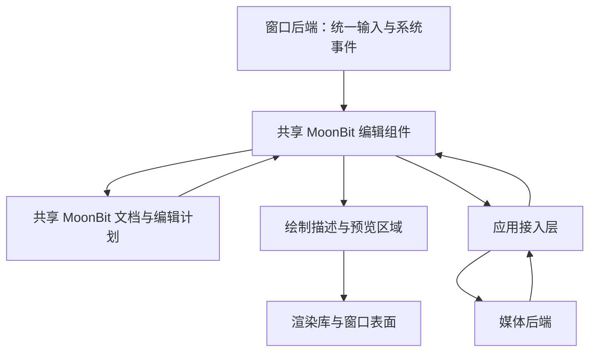

# 共享编辑组件约定

2026-11-17 目录决策更新：本文继续维护共享 UI 与媒体接口细节；最终目录、插件生命周期和 CLI 优先策略统一见[架构与实施规划](architecture.md)。截图 MoonBit 模块与录屏核心现已完成第一批迁移；下文保留尚未迁移的原生路径，不能据此继续扩展 components 或 plugins/feature 根目录。

状态：2026-11-18。三端正式视频编辑入口已经接入同一 MoonBit 根会话与 UI；macOS 本地回归，以及 Windows／Ubuntu 22 的媒体、实际编辑窗口和发行包检查通过，Ubuntu 24 的同一包运行检查通过。截图文字属性已接入下述共享字段协议，本批目标运行仍待 CI；不能因此将全部截图 UI 或插件 v2 记为完成。当前多片段、音轨与后续字幕/效果范围见[视频编辑器推进计划](video-editor-roadmap.zh-CN.md)。

## 一套复杂组件实现

视频编辑器及后续同类复杂组件用一套 MoonBit 代码实现布局、外观和交互。可以复用窗口、绘图、字体、通用控件和媒体库；macOS、Windows、Linux 的系统差异集中在后端接口中。

共享组件包含时间线刻度、剪辑块、播放头、缩放/滚动、命中与拖动、裁剪框、属性面板、工具栏、快捷键动作、焦点和无障碍语义。修改一个组件的行为或外观，应修改同一份组件代码；不同系统的按键符号、缩放和能力差异作为输入传入。

操作工具栏优先使用统一的共享矢量图标和固定点击区域；预览倍率与实际片段倍率使用不同图标，保留倍率数值。片段显示编号，时间码和必要的错误/进度信息继续保留。完整操作名、快捷键和禁用原因由 MoonBit 提供给悬停提示与无障碍标签；图标化减少常驻文字和翻译后的布局变化，不删除可访问名称。macOS 通用画布负责呈现系统提示，不能在原生层拼接产品文案。

只有几何计算或文档状态共享，平台分别拼装控件、处理手势，不满足这个约束。新组件不再分别建设 AppKit、Win32 和 Linux 专用视图。现有平台界面作为迁移基线保留，逐项由共享组件接替。

## 职责边界

| 层 | 所有内容 | 边界 |
| --- | --- | --- |
| 共享编辑组件（MoonBit） | 布局、样式、绘制/视图描述、交互暂态、焦点、语义节点、缩略图排列 | 不依赖应用设置域、草稿路径、录制入口、平台窗口/播放器类型 |
| 共享文档核心（MoonBit） | 编辑命令、校验、撤销重做、剪辑计划、原片与成片时间映射 | 沿用现有核心，不为新 UI 建立第二份权威文档或历史 |
| 应用接入层 | 连接组件与文档，提供素材和能力，执行保存/导出请求 | Mooji Cut 的草稿、插件、菜单和生命周期留在这里 |
| 窗口/渲染后端 | 原始输入转统一事件、逻辑坐标与缩放、文字排版能力、绘制呈现、IME/辅助功能系统桥 | 可使用现成库；不决定剪辑块样式、工具栏布局或编辑语义 |
| 媒体后端 | 视频加载、解码、播放时钟、seek、缩略图、画面/纹理、编码和结果回报 | 接收统一媒体请求与编辑计划，不拥有编辑器按钮和时间线 UI |

原生播放器可以先作为共享布局中的预览表面，位置、尺寸和覆盖关系由共享布局决定；播放按钮和时间线由共享组件负责。是否使用原生子视图或视频帧纹理，要通过嵌入验证决定，不提前绑定具体框架。

## 沿用截图的目录分层

本节标题保留供旧链接定位。下表区分已迁移的 MoonBit 包与仍在旧路径的宿主。目标按 capture/recording/video_editor 下的 core/ui/extensions 组织，平台实现进入 platform；截图尚非全部共享 UI，不能机械复制原生控件实现。

| 层 | 截图现状依据 | 视频现状及目标职责 |
| --- | --- | --- |
| 共享业务核心 | `src/internal/features/capture/core` 管图片与样式值域，capture 根包协调会话；`shared/geometry` 管共用几何，经根 ABI 暴露 | `src/internal/features/video_editor/core/legacy_document` 保留已有视频文档/API与时间线几何，录屏在 `features/recording/core`；`src/internal/features/video_editor/core` 已实现 v2 片段、恒速、链接、版本事务和 RenderPlan |
| 复杂 UI | `features/capture/ui` 的形状手势与定位已接入三端；文字属性新增同一 frame/fields 与根事务，原生桥保留系统输入；其余形状属性仍使用 `components/style_controls`，完整共享控件渲染未完成 | 已有 `src/internal/features/video_editor/ui` 负责布局、主题、交互和语义；播放条、时间线、属性面板按职责拆为包内模块，不能照搬三套原生 UI |
| 通用组件/后端 | `components/icons`、`style_controls`、`hud` 等已有实际组件 | 已有 `components/shared_canvas/macos`；仅解释通用绘制和输入协议。Windows/Linux 对应画布已在 platform/<os>/graphics 接入并通过目标自动验证；通用输入字段是本批新增能力 |
| 功能接入 | `plugins/feature/capture` 组织采集与编辑，`select`、`pin` 等各有入口 | 已有 `plugins/feature/recording` 与 macOS `video_editor`；保留录屏、草稿、窗口生命周期和媒体端口接线，不决定组件布局或剪辑规则 |
| 应用装配 | `native/*` 宿主、`build/native-modules.json` 的 sources/requires | macOS 正式构建已装配共享 UI、通用画布与媒体端口，录制完成和恢复草稿进入同一编辑窗；Windows/Linux 正式编辑窗口也已接入同一根会话 |

这里 `plugins/feature` 是内置功能的源码组织，`build/native-modules.json` 是原生构建依赖描述；它们不等于可导入的用户 Wasm 插件。现有 `src/internal/plugins/runtime/catalog` 和 `src/internal/plugins/contracts` 管工具目录与插件边界，不承接视频文档或播放规则。用户插件的录后编辑列表仍不能据此视为已有视频效果 API。

共享播放控制先在 `src/internal/features/video_editor/ui` 包内形成明确模块：统一观看状态、动作、可用性、焦点、布局和图标；`src/internal/features/video_editor/core` 管 v2 权威剪辑时间映射，媒体端口只执行 play/pause/seek/rate 并回报实际状态。确有第二个使用者时再提取独立 MoonBit 组件包与 C ABI，不预先虚构 `components/video_transport` 或第二套项目会话。`src/api_video_ui.mbt` / `bindings/c/video_ui.h` 保持薄边界，应用 feature 负责连接，不能把命中、按钮可用性或 1%/最多5秒跳转策略放回每端控制器。

通用绘制命令解释器可进一步复用跨平台 C/C++ 绘图与字体库，平台只留窗口、表面、设备和输入桥；尚未选择或接入新的库。共享的是 UI 规则、布局和语义，不保证不同系统字体栅格化像素完全相同。组件测量与绘制须使用一致字体度量；要求一致构图的字幕预览/导出使用同一字体资产和排版引擎，不能依赖三端系统字体替换后仍声称结果一致。

评审边界：原生层可以转换坐标/事件、测量或绘制通用文字、上传视频帧和执行媒体请求；若新增“这个按钮排第几”“这个片段拖动后变多长”“字幕随速度怎么移动”等判断，应回到共享 MoonBit。MLT 等媒体库只消费从 RenderPlan 派生的执行状态，不拥有另一份可独立编辑的项目。

## 当前实现与缺口

- `src/internal/features/video_editor/core` 提供正式编辑器的 v2 文档与编辑计划，`src/internal/features/video_editor/core/legacy_document` 保留视频 v1 兼容与共用几何，录制规则已迁到 `features/recording/core`；`src/internal/features/video_editor/ui` 包含共享布局、主题、绘制描述、命中、拖拽、焦点及语义状态。它消费权威文档快照并产生编辑请求，不建立另一份文档历史。
- `components/shared_canvas/macos` 解释通用绘制命令、转发输入与系统外观、呈现原生视频表面；`MCVideoMedia` 是独立媒体端口。`test/native/shared-video-ui.m` 将二者与 MoonBit 接起来，用生成的测试素材完成真实裁剪、播放及导出。通用画布属于平台适配，时间线本身没有 Objective-C 实现。
- macOS 的 `plugins/feature/video_editor/macos/MCVideoEditor.m` 已改为应用接入层：创建窗口和通用画布，连接共享会话、草稿与媒体请求。编辑器布局和产品交互由 MoonBit 决定，AVPlayer、AVComposition 与正式预览/导出由 `MCVideoMedia` 执行。
- Windows 的 `plugins/feature/recording/windows/recording.cpp` 里有 `buildEditor` / `editorProcedure`。当前预览通过外部系统播放器打开文件，尚没有可供共享 UI 控制的内嵌播放器接口。
- Linux 当前没有视频编辑器和对应媒体执行链。窗口适配已有并不等于视频预览、seek 和导出已经可用。
- 共享播放条已提供首尾、按成片 1%/最多5秒前后跳转、播放/暂停与 0.5–3×观看倍率；左右方向键逐帧定位，Shift 为十帧。v2 UI 还提供片段选择、切分、修剪、删除、按钮调序、实际速度、音轨展开/解除、独立偏移、全片静音和画面裁剪，都使用同一套核心命令，不另建文档历史。画面裁剪先预览，应用后提交一次，取消不修改文档；静音与裁剪同时影响预览、导出并可撤销。macOS 已接单素材音频包络与共享波形绘制；字幕和自由拖动重排尚未完成。
- 正式草稿保存到 `edit-v2.json`，保留 `source.mp4` 和旧 `edit.json`。存在 v2 时必须通过其格式与核心校验，损坏或不可读时不回退 v1；仅缺少 v2 时读取旧草稿并在内存迁移。恢复最近草稿会跳过无效候选，保留所有文件，找不到有效草稿才提示。保存失败保留内存编辑，并阻止关闭、退出及导出，允许修复后重试。

因此三端共用 UI 的约束已经明确，媒体能力的补齐仍需单独记录和验收。组件在缺少能力时统一展示相应状态，平台后端只报告能力，不另写一个简化版编辑器。

## 独立验证入口与集成约束

独立验证入口与 macOS 正式编辑窗使用同一份 MoonBit 组件和媒体端口，覆盖“视频预览 + 时间线 + 播放头 + 编辑 + 导出”。样例继续隔离验证底层接口，正式入口另行覆盖录制、草稿、退出与更新生命周期。

1. 同一份组件代码负责布局、绘制描述、命中、拖动、键盘和状态显示；平台入口只装配窗口、渲染与媒体后端。
2. 播放头跟随实际播放器时钟；seek 带请求标识，迟到的完成通知不能覆盖新的位置。明确区分原片时间和成片时间，剪接点与核心约定一致。
3. 拖动只更新预览；释放提交一次编辑，Esc、失去指针捕获或窗口关闭恢复临时状态。一次拖动只产生一个撤销步骤。
4. 视频区域随布局缩放；验证缩放比例、裁剪覆盖、焦点、鼠标在视频与工具栏之间移动，以及关闭后释放媒体资源。
5. macOS 覆盖与正式应用事件循环共存；Windows 后续需验证内嵌播放，Linux 需明确媒体后端和桌面环境。每端分别记录构建、显示、输入、媒体的通过/失败/未测，不能用跨平台编译成功代替交互实测。

复用文档会话时须统一句柄边界：`video_*` 的 session 可以为 0，`native_video_*` 的 handle 为 session + 1；转换集中在应用接入层。旧单段样例沿用 v1 格式；新 `video_project_*` 使用独立会话与 v2 文档，显式迁移旧草稿后不改写旧文件，不能由 UI 悄悄改变旧草稿语义。

基础交互和性能验证通过后，再完善专业编辑布局、缩略图缓存、更多编辑面板。只实现当前产品需要的组件，不以视频编辑器改造为由建设完整通用 GUI 框架。

## 后续拆库

先在本仓库保留清晰的模块边界，再提取共享组件及其测试、示例和必要后端接口。独立示例应能在没有 Mooji Cut 设置、录屏服务、插件和文件目录约定的情况下加载媒体并交互。

组件仅通过文档/媒体接口和事件与宿主通信；独立库不要求宿主接受 Mooji Cut 的安装路径、菜单、全局快捷键或更新机制。当前仍在验证阶段，不提前发布 SDK 或承诺稳定 ABI。

## 当前验证入口

`python3 scripts/check-shared-video-ui.py` 在 `.artifacts/shared-video-ui.noindex` 中构建独立样例，生成四秒测试视频、真实媒体读回报告、深浅主题渲染图和集成报告；不安装应用、不读取生产草稿或申请采集权限。加 `--interactive` 可打开生成的素材。

已验证：拖动预览不提交、取消恢复、一次手势一次提交、撤销重做、向外扩大已有裁剪时预览原片、真实播放器时钟、片尾重播、实际 MP4 导出、媒体同步失败后的禁用与恢复。真实窗口检查还覆盖了视频表面的定位、鼠标拖动和系统保存面板；独立离屏渲染不能代替这些检查。

新增 v2 路径用同一套共享 UI 和真实媒体完成：切成三段、调序、片段 3×、删除/撤销、修剪取消/提交、音轨解除与独立偏移、导出。视口支持缩放和平移，片段、播放头和裁剪把手按可见范围布局；视口不写入编辑历史。普通删除留下空隙，选中完整空隙后删除会合拢，Shift+Delete 一步删除并合拢；跨越空隙的独立音频会阻止操作，避免误删声音。`previewRate` 不进入文档或导出；片段实际速度通过 `video_project_command` 改变链接组与后片位置。当前有声慢放因平台算法尾部缺声而明确禁用；多文件、字幕和特效仍待实现。普通拖边缘仍为修剪，具体语义见[播放控制与片段变速](video-editor-roadmap.zh-CN.md#播放控制与片段变速)。

本轮 v2 验证包括真实 NSView 输入/媒体集成与组件离屏渲染。正式接入由 `test/native/recording-experience.m` 覆盖共享画布输入、核心与媒体同步、v2 保存重开、旧草稿只读迁移、严格恢复、写入失败后重试及退出保护；测试使用生成的媒体与隔离目录。正式应用接线与自动回归不等于人工验收，不能把上一轮单片段的桌面自动点击结果扩写成 v2 手动验收，也不能代替实际录屏权限和更新检查。

通用绘制协议目前采用批量 JSON，属于验证边界；大规模轨道/缩略图的性能仍需测量，后续可替换为紧凑命令缓冲而保留同一份组件逻辑。

## 共享可编辑字段与截图文字事务（2026-11-18）

本节记录本批源码契约；三端生产接入及验证状态以迁移台账为准。通用画布仍只负责绘制、静态语义和输入转换；系统文本输入是相邻的通用平台桥，不能把截图规则塞进画布。

- `shared/ui/fields` 保存有界 raw 草稿、UTF-16 选区、组合输入和草稿撤销；不解析数字、不决定空白正文是否删除图元。每个字段有不复用的 token 与递增 version。
- `shared/ui/frame` 增加 `editableFields`，与绘图命令并列。字段描述包含身份、raw、选区/marked、矩形/clip、字体/颜色/透明度、enabled/readOnly/focused 和可访问名称。正文只由真实文本输入对象呈现，不能再画第二份相同文字。
- selection 明确区分 `directed`、`undirected`、`unknown`。系统 API 没有提供光标位置或方向时如实报告，不能用 0 伪造事实。原生桥统一发送 LF 文本与 UTF-16 偏移；Windows EDIT 的 CRLF、GTK 的字符索引必须在系统边界转换。
- `ui_text_event` 与 C `mc_canvas_text_input_json` 编码替换、选区、compositionStart/Update/Commit/Cancel、草稿 undo/redo。事件携带字段 ID/token/expectedVersion，宿主同步应用根事件并回灌 ACK frame；退休字段的迟到输入无效。常规同 token/version 刷新只更新外观和几何，不能重置 IME。
- 真实输入控件提供 AX/MSAA/ATK 文本接口；frame 不再为同 ID 生成一份虚拟输入节点。父画布必须让实际输入节点可被遍历，不能只验证单个控件的 role。

截图文字扩展声明颜色、透明度和字号；capture 根包把属性描述和快照注入 capture/ui。圆色块直径、分组间距与属性行布局由 MoonBit 决定；平台只打开系统颜色选择器并返回颜色事实。

`capture_text_begin/event/prepare/cancel` 管同一个文字编辑事务。新文字与默认值可一起发布，已有文字编辑不改变工具默认值。透明度百分数与持久值 0..1 的换算、数字中间草稿、空白正文、字号范围及错误都由根会话决定。native 保留实际输入法、剪贴板、字体测量与图片光栅化。

`prepare` 仅生成候选：不结束 IME、不改焦点、默认值、文档或历史。预览候选不可提交；发布候选再次检查文档版本、编辑版本与样式版本，只能成功消费一次。多窗口配置用 `candidate_commit_many` 统一发布，原生焦点变化与控件拆除在全部文档发布之后发生。正文或字号未变时保留原文字框高度；改颜色、改透明度、打开再关闭都不触发重新排版。

`image_session_geometry` 是几何专用薄入口：冻结文档 revision 和稳定图元 ID，移动不重写正文/样式，`font_size=-1` 保留原字号，文字缩放可传小数。活动文字事务必须先提交或取消；旧的 pending-text／整数样式接口不再参与这条文字移动路径。原片和图片导出仍复用既有渲染器。

本切片不代表所有形状属性、通用用户插件属性 Schema、OCR 结果输入或 CLI 已完成；这些按各自工作包继续迁移。
