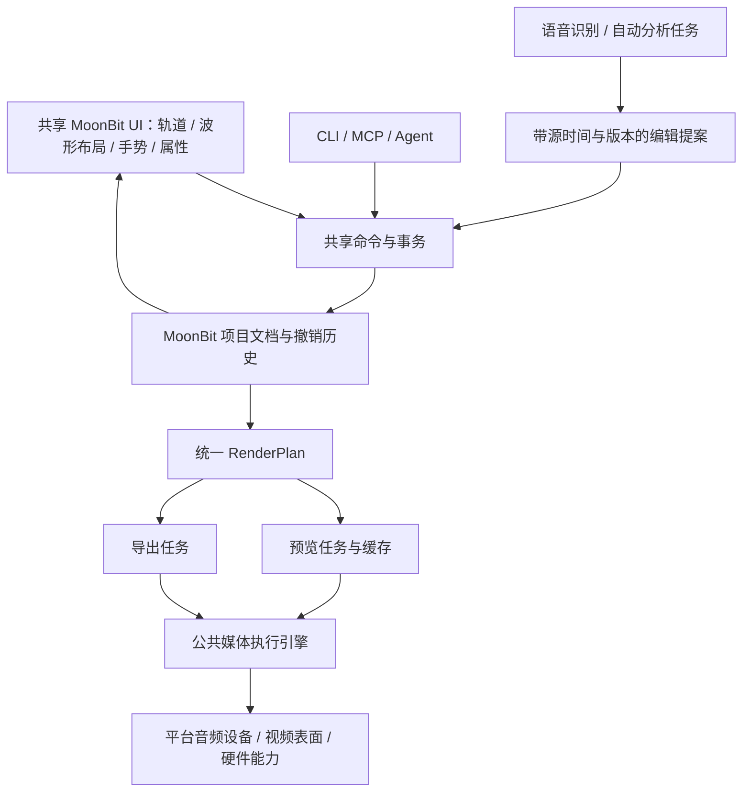

# Mooji Cut 视频编辑器推进计划

2026-11-16 更新。目标是提取专业编辑器最常用的剪辑能力，服务录屏讲解和科技内容制作。复杂界面、编辑规则和 Agent 操作共用 MoonBit 实现；底层窗口、绘图、媒体处理和语音识别可以复用库。

## 当前状态与这一轮范围

当前共享组件已支持单素材切分、多段修剪、调序/拼接、删除与空隙合拢、实际片段倍率、关联音轨展开/解除、独立音频偏移、全片静音、画面裁剪和真实导出。时间轴支持缩放、横向浏览和恢复适应全部，空隙可选中删除。布局、图标、菜单、命中和交互均由 MoonBit 实现；macOS 媒体端口执行 v2 RenderPlan。共享组件已替换 macOS 正式 App 的录后编辑窗，并接入草稿恢复；独立验证入口继续保留。此处记录源码接入状态，不代表已发布或完成人工验收。

界面去掉副标题和常驻教学文案，标题/图标居中对齐。前后跳转为 `min(成片总时长 × 1%, 5 秒)`，图标不显示数字。预览速度只影响观看；“片段速度”写入文档并改变成片。完整核心/媒体/输入回归可用 `python3 scripts/check-shared-video-ui.py` 重现。

工具栏操作统一使用图标；播放预览倍率与片段实际倍率以不同图标加 `1×` 等数值区分，片段标签使用编号。操作名、快捷键和禁用原因保留在悬停提示及无障碍名称中，集中在共享 UI 提供，避免翻译后工具栏宽度和对齐发生变化。时间码、处理状态与错误信息保留必要文字。

当前实现边界：

- 单一源文件可引用为多个稳定片段并调序拼接；多文件导入/拼接尚未接入。
- v2 使用 90,000 ticks/秒，输出暂固定 30fps。时间线边界按帧量化；切分的派生源边界保留整数 tick，共用分界确保源区间无缝。整数乘除和舍入避免长素材的浮点 half-tick 错误。
- 视频片段支持 0.25–4×；有声音频片段首版支持 1–4×。实测平台保音调算法在慢放时缺少尾音，因此关联音画/音频慢放在提交前拒绝，预览 0.5×不受此限制。UI 提供常用倍率，任意目标时长由核心命令提供；尚无目标时长输入框。
- 音画默认联动；解除后可以独立移动、修剪、变速或删除音频。普通删除片段保留间隙；选中间隙按 Delete/Backspace 或点删除，后片合拢；Shift+Delete/Backspace 可一步删除片段并合拢。独立音频操作不挤动视频；音频跨越待删间隙时原子拒绝，不暗中切掉声音。变速/修剪仍默认调整后片，尚无相应 UI 策略开关。
- 时间轴视口是 UI 暂态，缩放和平移不修改草稿或撤销历史。Command/Ctrl 加 `+` / `-` 以可见播放头为锚点缩放，否则以视口中心为锚点；加 `0` 适应全片。Command/Ctrl 加滚轮以指针为锚点缩放，普通滚轮横移。工具栏不显示缩放按钮，自动化 `project-zoom-*` 动作保持可用。裁剪不再缩短时间轴视口，保留恢复源片段的空间。最小视窗为三帧；左右方向键按一帧定位，Shift 为十帧。放大后裁剪把手只出现在真实且可见的片段边界。
- 全片静音与画面裁剪写入 v2 文档和媒体计划，同时作用于预览与导出，可撤销并随草稿恢复。画面裁剪先在共享画布上调整候选范围，应用时提交一次；取消不改文档，重置恢复完整画面。它不是逐片段关键帧裁剪或聚焦效果。
- 多段调序目前通过前移/后移按钮，尚无自由拖动重排；无重新关联、波形、缩略图缓存、字幕和转场。
- 原生 ABI 已提供同一套带 revision、批量事务和 requestId 的编辑命令，但正式视频 MCP/CLI 服务尚未接入。macOS 正式入口已接入 v2 原子保存、恢复和退出保护；自动回归使用生成素材验证，不代替人工录屏与更新验收。
- Windows 仍用旧录制/编辑宿主，Linux 尚无视频媒体链；新共享界面的对应宿主未接入，native/wasm 的核心测试不代表三个系统均已实装。

旧 `src/internal/video` 继续提供 v1 API。`src/internal/video_project` 承载 v2 文档与命令。正式编辑器优先严格校验 `edit-v2.json`，只有该文件不存在时才读取并迁移旧 `edit.json`；已有 v2 损坏或不可读时不退回旧版。新编辑写入独立 v2 文件，保留原片与旧文件。最近草稿恢复跳过无效候选且不改写它们；保存失败保留内存编辑，阻止关闭、退出与导出并允许重试。`MCVideoMedia` 同时接受 v1/v2 计划，不再要求 v2 区间按原片顺序排列。以下章节保留完整目标设计，其中字幕、效果、多素材等仍是后续计划。

## 交互目标

| 操作 | 用户看到的行为 | 编辑语义 |
| --- | --- | --- |
| 选择片段 | 点击选中，边缘高亮；多选后可一起处理 | 稳定片段 ID；选择属于 UI 暂态 |
| 切分 | 播放头处一键切分，左右成为两个可独立操作的片段 | 默认同时切分关联音视频，形成两组新的关联关系 |
| 修剪 | 拖两端预览起止，释放应用，Esc 恢复 | 不改原片；一次拖动一次撤销 |
| 移动/重排 | 拖动时显示插入线和目标位置，松手后重排 | 第一版使用明确的插入模式，不隐式覆盖别的片段 |
| 删除 | 分为“删除，保留空隙”和“删除并合拢” | 前者后片位置不变；后者压缩相应时间区间 |
| 删除空隙 | 点击两段之间的空隙，按 Delete 或点删除 | 删除该完整空隙，后片音画同步前移；可撤销 |
| 缩放时间轴 | 放大/缩小、滚轮横移、适应全部 | 只改变显示时间范围，不改变片段时长或导出 |
| 音轨展开 | 展开片段的声音行，显示波形、静音和音量 | 仅改变视图，不改变链接，也不复制文件 |
| 音画联动 | 默认显示链接状态，移动/修剪/分割/删除一起处理 | 音视频是独立片段，通过 linkGroup 关联 |
| 解除联动 | 解除后声音可单独调整，并能显示相对原同步位置的偏移 | 可撤销的文档操作；重新关联也可撤销 |
| 吸附 | 对齐片段边缘和播放头时显示对齐线 | 仅改变落点，不暗中移动后续片段 |
| 播放与浏览 | 统一的播放/暂停、前后定位、时间码与预览速度 | 只改变观看状态，不写文档或影响导出 |
| 片段速度/时长 | 输入倍率或目标时长，先显示成片时长变化再应用 | 同一保留源区间按新的时间映射输出；是一项可撤销的编辑 |

这是对专业操作的简化：Adobe 将普通删除与 ripple delete、选择关联内容与真正 unlink、展开音轨与 extract audio 分别处理。这里沿用其语义，使用明确的中文操作名。[剪切](https://helpx.adobe.com/premiere/desktop/edit-projects/trim-clips/cut-clips.html)、[删除](https://helpx.adobe.com/in/premiere/desktop/edit-projects/change-clip-sequence/remove-clips-from-a-sequence.html)、[音画关联](https://helpx.adobe.com/premiere/desktop/add-audio-effects/basic-audio-editing/link-audio-and-video-clips.html)、[提取音频](https://helpx.adobe.com/uk/premiere/desktop/add-audio-effects/basic-audio-editing/extract-audio-from-clips.html)。

第一轮只开放一条主视频轨与对应音轨，模型预留字幕、独立配乐和后续叠加轨道。“导出音频文件”作为单独操作，不能混入“展开音轨”或“解除联动”。自由多视频轨覆盖、多机位、嵌套序列、滑移/滚动剪辑暂不做。

独立音频跨越“删除并合拢”的边界时，必须有明确的切分与同步规则；规则未完成前拒绝该组合并说明原因。关联音视频占用同一时间区间时，合拢位移按区间并集计算，不能把时长扣两次。空隙必须在成片中真实表现为黑场/静音。

## 播放控制与片段变速

播放条使用同一份 MoonBit 布局、图标几何、命中区域、焦点与无障碍语义，提供清晰的播放/暂停、前后定位、当前位置/总时长和预览速度。按钮应有可访问名称和快捷键提示，不能仅靠文字长按钮或依赖某个平台的系统图标。必须区分“上一/下一帧”“前跳/后跳若干秒”“持续快进/快退”；跳转按钮仅用双箭头，不显示数字；步长由共享代码计算，不能把一次 seek 标成持续倒放。Premiere 的 J/K/L 分别用于向后浏览、暂停、向前浏览，重复按键可提高浏览速度；它们是预览控制的参考，不要求第一版复制全部组合键。[Adobe 播放控制](https://helpx.adobe.com/premiere/desktop/render-and-export/render-sequences-for-playback/play-clips-in-source-monitor.html)

预览倍率 `previewRate` 属于观看暂态，不写入 Clip、不增加文档 revision、不进入撤销历史，导出始终按项目计划执行。v2 逐帧定位依据当前 30fps 帧网格；后续开放其他帧率时须依据项目帧率，不能固定加减 33 毫秒。原生后端报告实际位置、播放方向和可用倍率，不能把请求成功等同已经按指定速度播放。暂不支持反向连续播放时保留明确的后跳，不显示虚假的倒放状态。文本输入和输入法组合期间不抢占播放快捷键。

片段恒速则改变项目：固定保留的源区间为 `S`，正有理倍率为 `r`，理想成片时长为 `S / r`。将完整 180 秒片段变为 60 秒，等价于 `r = 3/1`；这是时间压缩，不是删除其中两分钟，也不是只让用户以 3 倍速观看。属性面板允许选择“速度”或“目标时长”作为本次输入，核心计算另一项，不能保存两份可相互矛盾的权威值。普通拖片段边缘仍然是修剪，不隐式变成 Rate Stretch。初版只做正的恒定速度，必须覆盖 3 倍需求；零、负值、非法数值和超出已验收能力范围的请求拒绝并反馈范围。反向成片和 speed ramp 后置。Adobe 的 Speed/Duration 同时区分片段速度、声音音调和是否移动后续片段；这里采用下面更窄的明确规则，不照搬其不同版本的音频选项名称。[Adobe Speed/Duration](https://helpx.adobe.com/premiere/desktop/edit-projects/change-clip-speed/change-clip-speed-using-the-speedduration-option.html)

- 音画仍关联时，以共同同步锚点应用同一时间变换，保留原始流偏移；音频默认保持音调。解除关联后的音频不被偷偷改速，UI 显示同步偏移。暂不能正确处理的错位链接或重叠组合整批拒绝，不能只改视频后宣称同步。
- 片段起点固定，默认勾选“调整后续片段位置”，用新旧时长差移动约定同步范围内的后片，关联音视频只计一次；用户可取消勾选，此时后片位置保持不变，加速留下空隙，减速导致同轨重叠则拒绝，不覆盖或裁掉别的片段。执行前给出时长和受影响片段摘要，默认合拢也必须随变速一起可撤销。
- 源时间绑定的字幕、聚焦和关键帧通过同一映射换算，例如 `timelineStart + (sourceTime - sourceIn) / r`；已解除关联的旁白字幕跟随音频实例。项目时间绑定的独立标题不随片段变速。3 倍压缩可能让字幕来不及阅读，应提示复核，不能自动改写文本。分割已经变速的片段时保留倍率与同步锚点，两个子片段的总结果不应跳帧或丢声音。
- 核心用有理时间和有理倍率计算，不反复从显示的小数秒反算。目标时长需先按项目视频帧网格量化并回报实际值，再计算倍率；量化统一采用就近取整、恰半帧向后。音频边界从同一有理时间换算到采样网格，不按每段四舍五入后累计。倍率输入的理想时长与可输出帧数也要明确区分，并由预览和导出共用同一舍入规则。
- 面板输入或拖动只生成预览，确认形成一次事务，包含变速、字幕/效果映射与后片位移；Esc 取消不改文档。撤销恢复整组状态，Agent 使用同一规则，不单独拼接媒体命令。

媒体执行须同时处理视频时间戳与音频时伸缩。FFmpeg 的 `setpts` 可缩放视频时间；`atempo` 调节音频节奏，超过 2 倍时官方提示会跳过部分样本，可拆为多个因子相乘，例如 3 倍使用 `atempo=1.5,atempo=2`。`rubberband` 可独立设置 tempo 与 pitch，保音调候选路径为改变 tempo、保持 pitch 为 1，但需额外依赖和许可证核对。本轮不据此选择或引入新库；保音调、音画同步及边界样本必须实听、读回验证，不能只修改音频 PTS 或采样率就宣称完成。[FFmpeg setpts](https://ffmpeg.org/ffmpeg-filters.html#setpts_002c-asetpts)、[atempo](https://ffmpeg.org/ffmpeg-filters.html#atempo)、[rubberband](https://ffmpeg.org/ffmpeg-filters.html#rubberband)

## v2 项目模型

| 对象 | 保存的信息 |
| --- | --- |
| Asset | 稳定素材 ID、文件引用/指纹、媒体流、原始时间基、帧率、方向、画面和声音信息 |
| Clip | 稳定实例 ID、assetId、streamId、trackId、源起止、时间线起点、正有理恒速/时间映射、保音调策略、效果引用 |
| Track | 视频/音频/字幕类型、顺序、锁定、静音及明确的同步范围 |
| LinkGroup | 音视频成员、原始同步对应和允许的联动操作；与普通多选组分开 |
| Caption | 可编辑文本、时间范围、样式、所绑定的片段/源音频或项目时间 |
| Effect / Transition | 参数、关键帧、缓动；转场还引用相邻片段及重叠时长 |
| Project | schemaVersion、revision、时间线、素材表、输出配置 |

素材独立保存，片段只是引用；同一素材可出现多次。分割和重排操作不改写源文件。需要保留多个片段同时活动的表达能力：转场时不能再用“当前时间只对应一个原片时间”的旧接口。

文档采用明确的有理时间（整数 value 与 rate），保留源 PTS、项目帧边界与音频采样边界的换算规则；显示可以用秒或帧，像素只属于 UI。不能继续把整数毫秒当作所有素材的精确边界，也不能把音视频各自归零后丢失原始同步偏移。相关时间、轨道和片段概念可参考 OTIO；它是编辑交换模型，不能当作播放器或渲染器。[OTIO 概述](https://opentimelineio.readthedocs.io/en/latest/)

v1→v2 迁移按现有保留区间生成有序片段，保留静音和裁画面结果。先生成新版本草稿并验证结果，旧草稿保留；旧应用遇到不支持的新版草稿应拒绝编辑，不能重写成丢失轨道的 v1。

迁移后的片段倍率默认为 `1/1`。RenderPlan 包含片段的源区间、输出区间、时间映射和音频策略，但不包含观看用的 `previewRate`；旧媒体端口不能执行变速时应报告能力不足，不能静默按原速导出。

## 复用架构

共享范围包括片段编辑、链接、吸附规则、缓动、字幕时间映射、布局、绘制描述和交互。平台后端只接窗口、原始输入、绘制表面、权限、设备与编码器；不会出现三套 timeline、三套字幕布局或三套关键帧曲线。

目录分工沿用截图实际已有的组件、功能接入与共享核心层次，但不复制截图遗留的三端原生界面。`src/internal/video_ui` 承载复杂 UI，`src/internal/video_project` 承载 v2 文档与 RenderPlan，`src/internal/video` 保留 v1 兼容；macOS 的 `plugins/feature/video_editor` 已拆为应用接线与媒体适配，`components/shared_canvas` 解释通用绘制/输入。播放条、时间线和属性面板目前是 `video_ui` 包内职责，不虚构已经存在的独立包。完整现状与目标映射见[共享编辑组件的目录约定](shared-editor-ui.zh-CN.md#沿用截图的目录分层)。

FFmpeg 可执行裁剪、拼接、滤镜和输出；项目规则仍由 MoonBit 产生。RenderPlan 是结构化数据，不是让 Agent 或 UI 拼接 shell 命令。后端将其编译成受控参数/滤镜图。

媒体执行优先验证 MLT：它已有 C 接口的时间线组合、多轨、转场、关键帧及帧/声音输出，能减少直接围绕 FFmpeg 自建播放调度的工作。MLT 接收由 RenderPlan 派生的组合，MoonBit 文档始终是权威；不把 MLT 对象另存为一份可独立编辑的项目状态。[MLT 架构](https://www.mltframework.org/docs/framework/)、[时间线接口](https://github.com/mltframework/mlt/blob/master/src/framework/mlt_playlist.h)、[帧接口](https://github.com/mltframework/mlt/blob/master/src/framework/mlt_frame.h)

这个选择仍需小样证明：两片段重排、独立音轨、一个关键帧/转场，测 seek、音画同步、预览与输出一致性及三端构建。MLT 的消费者回调与帧所有权需要 C 桥接；现有 AVPlayerLayer 不能直接消费 MLT 时间线，应新增通用帧呈现 adapter。先记录源码可行性，尚未宣称已在本仓库运行。[MLT 帧/音频调度](https://github.com/mltframework/mlt/blob/master/src/modules/sdl2/consumer_sdl2_audio.c)

libopenshot 暂保留为备选：其 C++ 时间线 API 同样可复用，但现有构建依赖 Qt 图像/GUI 模块和其他库，会增加桥接与分发成本，不在本轮同时引入第二套引擎。[libopenshot 依赖](https://github.com/OpenShot/libopenshot/blob/develop/src/CMakeLists.txt)

预览和导出消费同一份 RenderPlan。基础剪辑可继续使用现有播放器；复杂效果第一步可以生成低分辨率缓存片段，但需要明确显示预览更新状态，旧任务不得覆盖新 revision。若交互延迟不达标，再采用共享的持续解码/滤镜/音频时钟引擎，不能把频繁启动 FFmpeg 进程称作实时播放器。

## 字幕与科技内容常用效果

| 优先级 | 能力 | 实现边界 |
| --- | --- | --- |
| 第一批 | 手动字幕、SRT 导入/导出、自动转写后校对 | 字幕是可编辑轨道；转写结果保留源时间和生成版本，不覆盖手动修订 |
| 第一批 | 点选区域聚焦、平滑放大、保持、返回 | 共享关键帧曲线；用少量参数封装常见动作，可继续精调 |
| 第一批 | 淡入淡出、简单叠化与声音淡变 | 明确片段重叠时长和总时长变化，不自动添加不可见停帧 |
| 第二批 | 波形、音量、淡入淡出、旁白与配乐压低 | 共用音频混音计划；先确保关联编辑和同步，再增加复杂混音 |
| 第二批 | 静音区间检测与剪除建议、按文稿定位 | 分析生成可撤销的编辑操作，不直接改写原始文件 |
| 第二批 | 点击高亮、鼠标跟随聚焦、画面背景与圆角 | 先支持手动位置/Agent 提供区域；自动跟随需要可用的事件元数据或可靠检测 |

FFmpeg 已有 `trim/atrim/concat`、字幕滤镜、`zoompan` 和 `xfade/acrossfade`。字幕烧录需 libass；视频转场需统一输入尺寸、像素格式、帧率与时间基。`zoompan` 处理视频时要明确帧率和每次输入对应帧数，不能改变原时长。[FFmpeg 滤镜文档](https://ffmpeg.org/ffmpeg-filters.html)

字幕预览与导出应使用同一字体资产和布局引擎。自动转写可接入 whisper.cpp 一类本地引擎，或独立服务提供者；识别耗时、模型大小和语言效果需实测。转写、断句与翻译属于可替换任务，不放进 UI 组件。[libass API](https://github.com/libass/libass/blob/master/libass/ass.h)、[whisper.cpp](https://github.com/ggml-org/whisper.cpp)

字幕和聚焦默认绑定所属片段/源时间，重排时随片段移动；独立片头标题可绑定项目时间。分割跨越字幕/关键帧时应产生保持可见结果的子范围；不能把所有字幕都存成全局绝对秒数。针对旁白生成的字幕应跟随相应音频实例，不强行跟随已经解除关联的视频。

## Agent 从基础层接入

v2 共享核心已实现 expectedRevision、原子批量事务、requestId 重试去重及共同撤销历史，UI 已调用这些命令。正式视频 Agent 服务仍待接入，下一阶段是把相同协议接到实际 MCP/CLI 传输入口。

传输层保留少量能力入口（以下不是当前已注册工具名；对应编辑核心已有实现）：

- `project.inspect`：读取 revision、素材、片段 ID、轨道、链接和能力。
- `timeline.apply`：按稳定 ID 提交 split、trim、insert/move、remove、link/unlink、setSpeed、caption、effect 等操作；携带 expectedRevision 和 requestId。
- `timeline.preview`：在指定 revision 与时间/片段范围生成预览、变更摘要或试运行结果。
- `job.start/status/cancel`：转写、波形、代理预览及导出，带来源版本、进度和取消标识。
- `project.undo/redo`：人工与 Agent 共用历史，批量操作形成一次撤销。

一次批量编辑要么全部成功、revision 增加一次，要么保持原文档。过期版本返回冲突；相同 requestId 的重试不得重复切分或导出。异步分析只应用到仍匹配的素材与文档版本，迟到结果不能覆盖用户新编辑。

核心 `setSpeed` 协议已包含 `clipId`、`rate` 或 `targetDuration` 二选一、`preservePitch`、明确的 linked 范围与 ripple 策略。响应回报规范化倍率、实际时长、后片位移和受影响的关联对象；同一批次只撤销一次。另行控制预览播放时，只调用观看会话的 transport，不伪装成 `timeline.apply` 或修改项目 revision。

例如“删除第二段，将第三段放到开头，生成中文字幕，并在讲按钮时放大右下角”，Agent 应先读片段 ID，提交可验证的编辑事务，再发起转写任务和聚焦效果请求。结果可预览、可撤销；同一组命令也可用于无窗口批处理。MCP/CLI 是传输适配，不另写一套剪辑规则。

## 推进次序与验收

| 阶段 | 交付 | 验收重点 |
| --- | --- | --- |
| 0：共享基线 | 中性明暗主题、现有共享样例、播放条/前后定位/预览速度、媒体引擎小样比较 | 同一份 UI；真实视频表面、输入、取消；预览速度不改导出；明确三端能力差距 |
| 1：编辑文档与命令 | v2、迁移、稳定 ID、批量事务、分割/删除/重排/链接、恒速与目标时长、Agent 命令接口 | 无 UI 重放编辑；180 秒→60 秒、链接同步、ripple 与舍入；撤销恢复；人工/Agent 结果相同 |
| 2：可用时间线 | 多片段 UI、吸附、波形/缩略图缓存、音轨展开/联动、速度/时长属性，共用媒体计划 | 切分→移动→变速→删除→撤销→保存重开→导出；三端同一序列，真实成片时长与保音调验证 |
| 3：字幕与自动化 | 手动/SRT/自动转写、任务取消、字幕跟随片段 | 调序和切分后字幕仍对齐；旧任务不覆盖校对；预览与输出一致 |
| 4：内容制作预设 | 聚焦、缓动、淡变、简单转场、配乐控制 | 关键帧和转场中点逐帧对照；声音无重复、丢段或累积漂移 |
| 5：应用接入与拆库 | macOS 宿主与 v2 草稿已接入；继续补齐其他平台、提取独立库、更新交付 | 现有功能无回退；库不依赖 Mooji Cut 路径/设置；通过原有更新流程 |

恒速与目标时长是阶段 1/2 的基础能力。speed ramp、反向成片和光流补帧在恒速闭环验收后另排，不因专业播放条已经可用而标记为完成。

三平台构建和固定媒体用例从阶段 1/2 就加入，不等 macOS 全部做完再补。每种能力同时记录“模型支持、UI支持、预览支持、导出支持、Agent支持”，避免出现一个按钮存在就标成已完成。

一致性要求是相同剪辑结果、时序、构图、字幕、音画同步与交互规则，不要求不同硬件编码器输出相同文件字节。固定软件处理路径作参考，再验证硬件加速路径。对 Linux 明确测试的显示协议与音频环境。

媒体打包使用固定版本和可复现构建。FFmpeg 的许可取决于编译选项与依赖，不能假设所有下载包都采用同一许可；尤其需要核对 x264/GPL 与 nonfree 配置。这个检查在引入依赖时完成，不要求用户手工安装工具链。[FFmpeg 许可说明](https://ffmpeg.org/legal.html)、[构建许可条件](https://github.com/FFmpeg/FFmpeg/blob/master/LICENSE.md)

## 下一次可见交付

本轮交付 macOS 正式入口中的“单段录屏切分、按钮调序、音轨展开/解除、恒速压缩、删除并合拢、撤销、静音/裁画面、草稿恢复和导出”，并沿现有签名更新链准备版本。发布和实际升级需单独验收。后续补自由拖动重排、等价的 Agent 传输入口与其他平台媒体宿主；长录屏的音画同步和保音调仍须专项验收，短合成素材不能代替。字幕与效果继续沿同一模型扩展。
